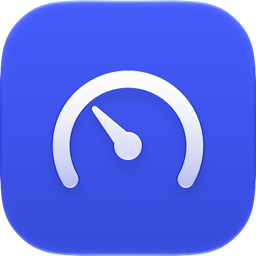
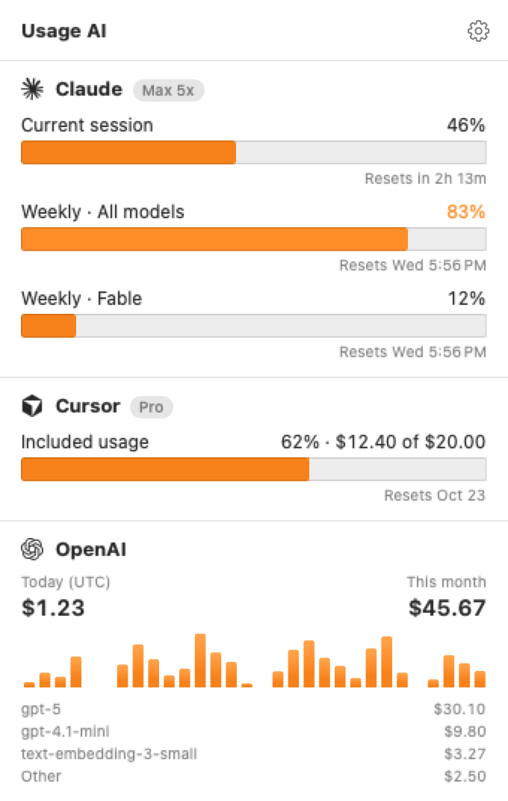
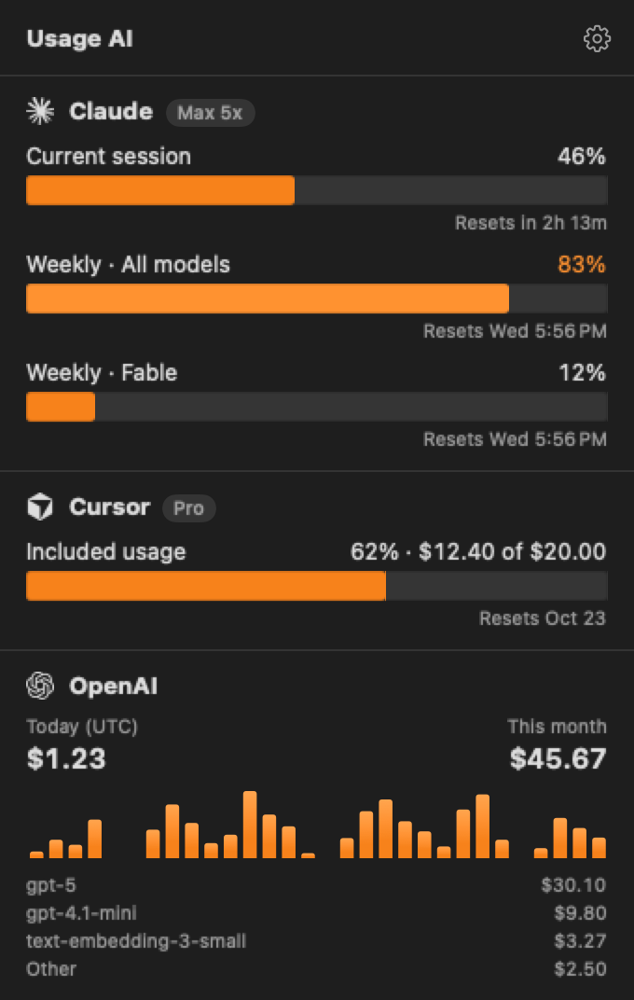
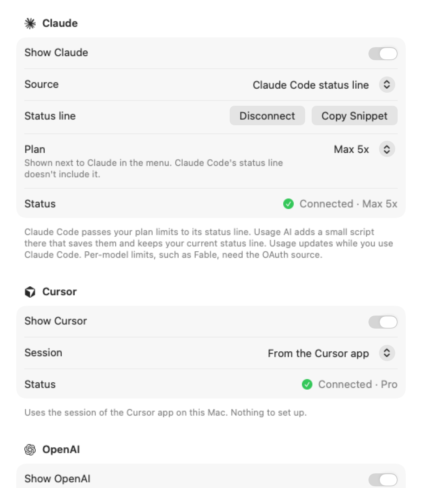
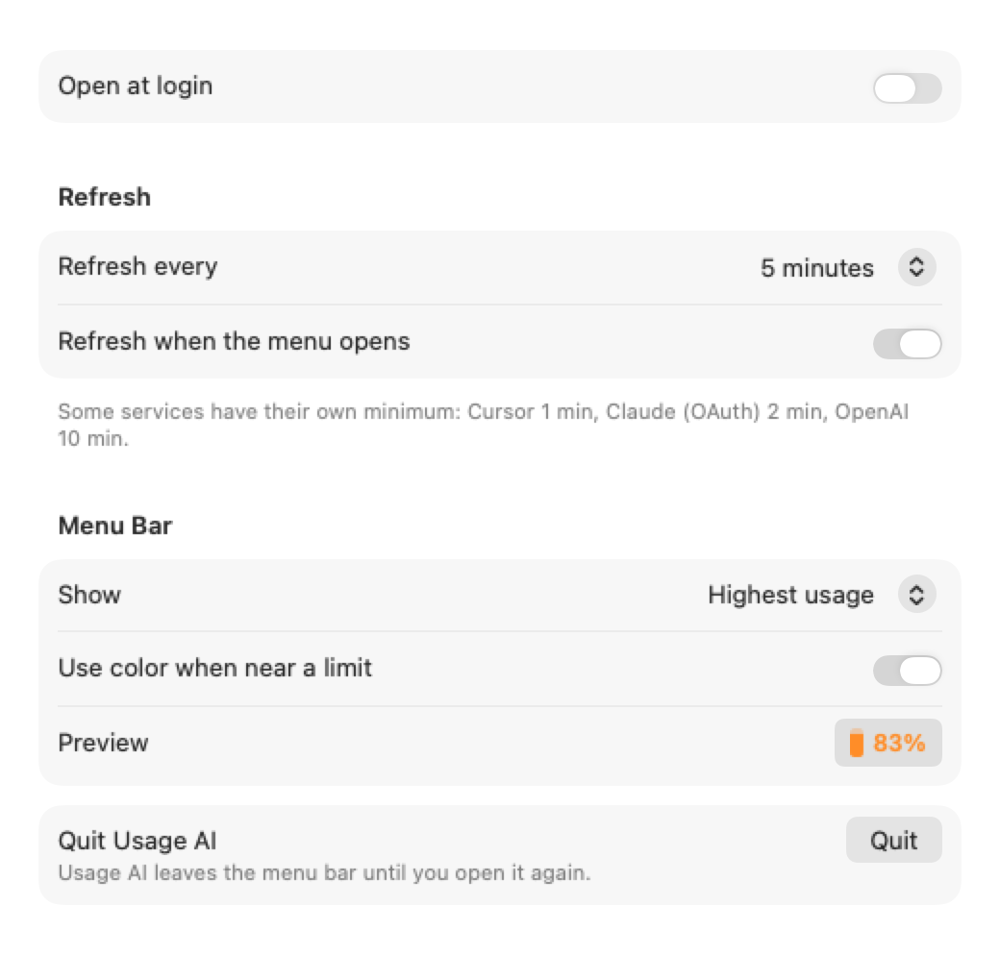
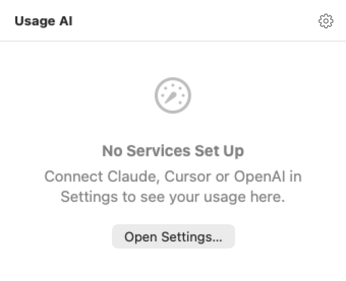

<p align="center">
  
</p>

<h1 align="center">Usage AI</h1>

<p align="center">
  A small, native macOS menu bar app that shows how much of your AI subscriptions you've used:<br>
  <b>Claude</b> (Pro/Max), <b>Cursor</b> and <b>OpenAI API</b> spend, all in one place.
</p>

<p align="center">
  
  &nbsp;
  
</p>

- Native SwiftUI. No Electron, no third-party dependencies, a few MB of memory.
- Follows the macOS Human Interface Guidelines: the system's Liquid Glass and materials, your accent color, light/dark mode, VoiceOver labels, and an Icon Composer app icon.
- Configurable menu bar item: a small vertical bar that fills up with your highest usage, a metric you pick, or one value per service next to its logo. It turns orange at 80% and red at 95%.

  <picture>
    <source media="(prefers-color-scheme: dark)" srcset="docs/menubar-highest-dark.png">
    
  </picture>
  &nbsp;
  <picture>
    <source media="(prefers-color-scheme: dark)" srcset="docs/menubar-perService-dark.png">
    
  </picture>

- English and Brazilian Portuguese (follows the system language).
- Keeps the last known numbers when you're offline, and backs off when a service rate-limits.

> [!WARNING]
> Claude and Cursor don't offer official usage APIs for subscriptions. Usage AI relies on
> undocumented data that can change or break at any time. It is not affiliated with Anthropic,
> Anysphere or OpenAI. Use it at your own risk.

## What it shows

| Service | Data | Source |
|---|---|---|
| **Claude** | Current (5-hour) session and weekly limits, with reset times | Claude Code's status line (default), or the unofficial OAuth usage endpoint, which adds per-model weekly limits such as Fable |
| **Cursor** | Included usage (% and $), Auto / API pools, on-demand spend, billing cycle reset | The Cursor app's local session + `cursor.com/api/usage-summary` (unofficial) |
| **OpenAI** | Spend today and this month, top models, last 30 days, optional monthly budget | Official [Costs API](https://platform.openai.com/docs/api-reference/usage/costs) with an Admin key |

## Install and run locally

Usage AI isn't on the App Store and there's no prebuilt download yet: you build it on your Mac
with Xcode. It takes a few minutes and needs no Apple Developer account.

### Requirements

- macOS 14 Sonoma or later (Apple silicon or Intel)
- Xcode 26 or later, free on the Mac App Store
- [XcodeGen](https://github.com/yonaskolb/XcodeGen) only if you change `project.yml` (the generated Xcode project is in the repository)

### 1. Install Xcode

1. Install **Xcode** from the [Mac App Store](https://apps.apple.com/app/xcode/id497799835).
2. Open it once, accept the license and let it install its components.
3. Make sure the command line tools use it:

   ```sh
   sudo xcode-select --switch /Applications/Xcode.app
   xcodebuild -version   # should print Xcode 26 or later
   ```

### 2. Get the code

```sh
git clone https://github.com/JPLeopoldino/usage-ai.git
cd usage-ai
```

### 3. Build and install

```sh
make install
```

This builds a Release version, copies it to `/Applications/Usage AI.app` and opens it. When it
prints *"Usage AI is running"*, look for the usage bar in the menu bar, next to the clock.
Usage AI has no Dock icon or window of its own; everything happens from the menu bar.

> [!TIP]
> On a MacBook with a notch, a crowded menu bar can hide new items behind the notch. Quit an app
> with a menu bar icon, or hold <kbd>⌘</kbd> and drag icons to make room.

### 4. Connect your services

Click the menu bar item, then the gear (or press <kbd>⌘</kbd><kbd>,</kbd>) to open Settings, and go
to **Accounts**. Each service has its own steps, described in [Setup](#setup). The menu shows a
service as soon as it's connected.

### 5. Open at login (optional)

Turn on **Settings › General › Open at login**. It records where the app lives, so install it in
`/Applications` (step 3) first.

### Open it again after quitting

Quitting (**Settings › General › Quit**) removes Usage AI from the menu bar. Open it again from
Spotlight (<kbd>⌘</kbd><kbd>Space</kbd>, type *Usage AI*) or the Applications folder.

### Update

```sh
git pull
make install
```

Your settings, keys and the Claude Code connection are kept.

### Run from Xcode (development)

Open `UsageAI.xcodeproj`, pick the **UsageAI** scheme and press <kbd>⌘</kbd><kbd>R</kbd>, or run
`make run` to build a Debug version and open it. See [Development](#development) for the other
commands.

### Signing

The project builds with **Sign to Run Locally** (ad-hoc), so no Apple Developer account is
needed. To sign with your own team (recommended if you use the Claude OAuth source, see
[Permissions](#permissions)), copy `Config/Local.xcconfig.example` to `Config/Local.xcconfig` and
fill in your team ID. That file is gitignored.

### Uninstall

1. If you connected Claude Code, click **Settings › Accounts › Claude › Disconnect** first. It
   restores your previous status line.
2. Quit Usage AI and delete `/Applications/Usage AI.app`.
3. To remove its data too:

   ```sh
   rm -rf ~/Library/Application\ Support/UsageAI
   defaults delete io.github.jpleopoldino.UsageAI
   ```

   Saved keys (OpenAI Admin key, Cursor cookie) are in **Keychain Access**, under
   `io.github.jpleopoldino.UsageAI`.

## Setup

Open the menu bar item → gear → **Accounts**. The menu only lists the services you've set up; the others wait in Accounts until you do.

<p align="center">
  <picture>
    <source media="(prefers-color-scheme: dark)" srcset="docs/settings-accounts-dark.png">
    
  </picture>
  &nbsp;
  <picture>
    <source media="(prefers-color-scheme: dark)" srcset="docs/settings-general-dark.png">
    
  </picture>
</p>

Until a service is set up, the menu points you to Settings:

<p align="center">
  <picture>
    <source media="(prefers-color-scheme: dark)" srcset="docs/menu-empty-dark.png">
    
  </picture>
</p>

### Claude

**Claude Code status line (default, recommended).** Claude Code passes your plan's `rate_limits` to its [status line](https://code.claude.com/docs/en/statusline) command. Click **Connect…** and Usage AI:

1. installs a small script at `~/Library/Application Support/UsageAI/claude-statusline.sh`;
2. backs up `~/.claude/settings.json` to `settings.json.usage-ai-backup`;
3. points `statusLine.command` at the script. If you already had a status line, the script runs it afterwards, so it looks the same; if not, it prints nothing.

The numbers update while you use Claude Code (after each response). **Disconnect** restores your previous status line. Prefer to edit the file yourself? Use **Copy Snippet**. Claude Code only passes the session and weekly limits, so per-model limits (such as Fable) need the OAuth source. It doesn't pass your plan either: pick it under **Plan** to show it next to Claude in the menu.

**OAuth endpoint (optional).** Reads the login Claude Code keeps in the Keychain and calls `api.anthropic.com/api/oauth/usage`. It updates even when Claude Code is closed and shows per-model weekly limits, but it is undocumented, rate-limits aggressively, and Anthropic's terms restrict using subscription logins in third-party tools. Usage AI never refreshes or writes that token.

### Cursor

Nothing to do if the Cursor app is installed and signed in: Usage AI reads its session token (read-only) from Cursor's local database. If that doesn't work, pick **Session cookie** and paste the `WorkosCursorSessionToken` cookie from cursor.com.

### OpenAI

Create an **Admin key** at [platform.openai.com › Organization › Admin keys](https://platform.openai.com/settings/organization/admin-keys) (only organization owners can; a read-only key is enough) and paste it in **Admin key**. Optionally set a monthly budget to get a gauge and warnings, and a project ID to filter.

OpenAI has no API for the remaining credit balance, so Usage AI shows spend. Cost data is grouped by UTC day and can lag by a few minutes.

## Permissions

- **Keychain (Claude OAuth source only).** macOS asks whether Usage AI may read the `Claude Code-credentials` item. Choose **Always Allow**. With ad-hoc signing, each new build is a "different app" to the Keychain, so the prompt comes back after rebuilding; signing with a personal team avoids that. Background refreshes read it without UI and the prompt is meant to appear only after you click **Allow Access…** next to Keychain.
- **Your own secrets** (OpenAI Admin key, Cursor cookie) are stored in your login Keychain under the app's bundle ID.
- The app is not sandboxed (it needs to read Claude Code's and Cursor's data), and runs with the hardened runtime.

## Privacy

Usage AI only talks to `api.anthropic.com` (OAuth source), `cursor.com` and `api.openai.com`, with your own credentials. There is no analytics or telemetry. Redirects to other hosts are refused so credentials can't leak. Logs never contain tokens, cookies, emails or response bodies. The last snapshot is cached in `~/Library/Application Support/UsageAI/` so the menu has numbers right after launch.

## Troubleshooting

| Message | What to do |
|---|---|
| *Waiting for Claude Code* | Send a message in Claude Code. The status line only runs during a session. |
| *Claude Code's login expired* | Run `claude` in Terminal (OAuth source). |
| *Sign in to the Cursor app* | Open Cursor and sign in, or use the session cookie option. |
| *This OpenAI key can't read costs* | Use an **Admin** key, not a project/API key. |
| *Rate limited* | Nothing; Usage AI waits and retries with backoff. |

**Copy Diagnostics** (Settings › About) copies states and error codes, never tokens or usage values, so it is safe to paste into an issue. Logs: `log stream --predicate 'subsystem == "io.github.jpleopoldino.UsageAI"'`.

## Development

```
Sources/App         @main, composition root, Settings/menu bar workarounds
Sources/UI          menu bar label, popover, Settings (all user-facing strings)
Sources/Core        models, store, scheduler, HTTP, Keychain, SQLite (framework UsageCore)
Sources/Providers   Claude, Cursor, OpenAI
Tests               Swift Testing suites + JSON fixtures
scripts             endpoint spikes (bash + curl) and the icon generator
```

```sh
make generate   # regenerate UsageAI.xcodeproj from project.yml (XcodeGen 2.46.0)
make test       # run the unit tests
make run        # build Debug and open it
```

`project.yml` is the source of truth; commit the regenerated `UsageAI.xcodeproj` with it (CI checks they match).

The app icon is an Icon Composer file, `Resources/AppIcon.icon`, so macOS 26 and later render it with Liquid Glass and Xcode generates flat images for older releases. `swift scripts/make-icon.swift Resources/AppIcon.icon` writes it (the gauge is drawn there, since SF Symbols can't be used in app icons); you can also open it in Icon Composer.

Debug builds can render the menu, the menu bar item and Settings with sample data (light and dark, at 2x), which is how the screenshots above are made:

```sh
make build
"build/DerivedData/Build/Products/Debug/Usage AI.app/Contents/MacOS/Usage AI" \
  -renderScreenshots /tmp/shots -AppleLanguages '(en)' -AppleLocale en_US
```

To add a language, add it to `Resources/Localizable.xcstrings` in Xcode and run the `UsageAI` scheme with `-AppleLanguages (<code>)` (the `UsageAI-ptBR` scheme shows how).

## Acknowledgements

[CodexBar](https://github.com/steipete/CodexBar) by Peter Steinberger, for documenting the Claude and Cursor endpoints.

The service logos come from [LobeHub Icons](https://github.com/lobehub/lobe-icons) (MIT, see [THIRD_PARTY_NOTICES.md](THIRD_PARTY_NOTICES.md)). Claude, Cursor and OpenAI and their logos are trademarks of their owners, used here only to identify each service.

## License

[MIT](LICENSE)
